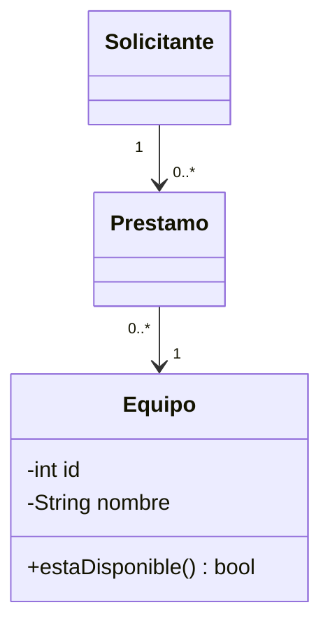
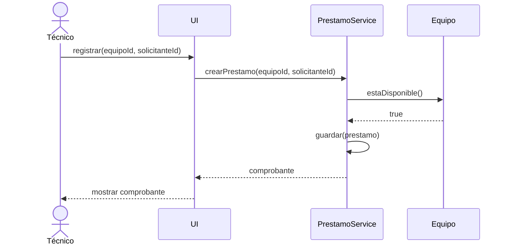
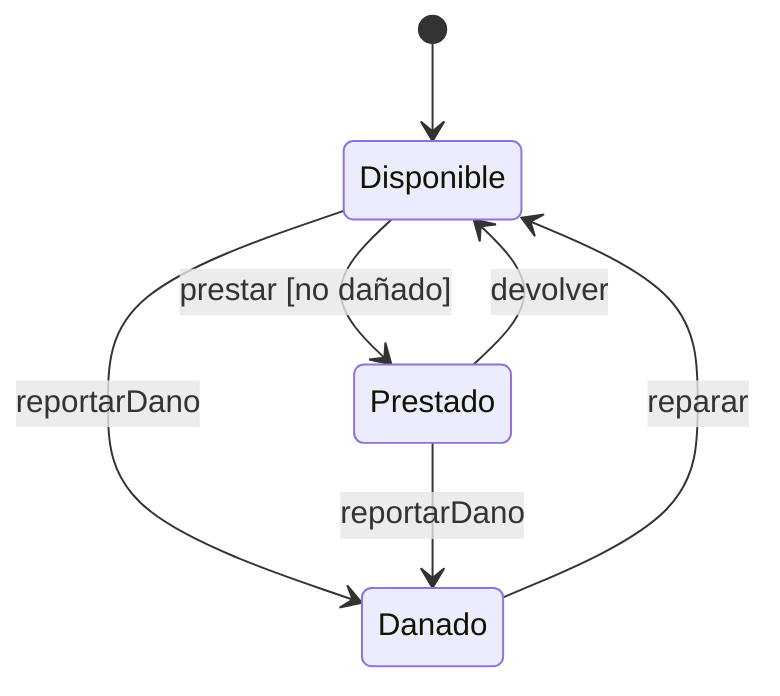

# IS 04 - Modelado con UML

Materia: [[Ingeniería de Software]]
Anterior: [[IS 03 - Casos de uso e historias de usuario]]
Siguiente: [[IS 05 - Principios de diseño y SOLID]]

## Contexto y objetivo
UML (Unified Modeling Language, OMG, estándar ISO/IEC 19505) es un lenguaje gráfico para visualizar, especificar, construir y documentar sistemas. No es una metodología: es notación. Esta clase recorre los diagramas más usados con su sintaxis y un ejemplo coherente (sistema de préstamo de equipos). Complementa la nota breve UML y patrones de diseño.

## Clasificación de diagramas (UML 2.x)
- **Estructurales**: clases, objetos, componentes, despliegue, paquetes, estructura compuesta, perfiles.
- **De comportamiento**: casos de uso, actividades, máquina de estados.
- **De interacción**: secuencia, comunicación, tiempos, visión de interacción.

Regla práctica: no dibujes todos; elige los que respondan preguntas del equipo ("¿cómo colaboran los objetos?", "¿dónde se despliega?").

## Diagrama de clases
Elementos: **clase** (nombre, atributos, operaciones), visibilidad (+ público, - privado, # protegido, ~ paquete), tipos y multiplicidades.

Relaciones:
- **Asociación**: línea; con multiplicidad (1, 0..1, 0..*, 1..*) y rol. 
- **Agregación** (rombo vacío): "tiene un", las partes pueden existir sin el todo.
- **Composición** (rombo lleno): el ciclo de vida de las partes depende del todo (Pedido y LíneaPedido).
- **Generalización/herencia** (flecha triángulo vacío): "es un".
- **Realización** (línea punteada con triángulo): clase implementa interfaz.
- **Dependencia** (flecha punteada): uso temporal (parámetro, variable local).

Ejemplo textual (PlantUML):
```plantuml
@startuml
class Equipo {
  - id: int
  - nombre: String
  - estado: Estado
  + estaDisponible(): boolean
}
class Prestamo {
  - fechaPrestamo: Date
  - fechaDevolucionPrevista: Date
  + estaVencido(): boolean
}
class Solicitante { - cedula: String; - nombre: String }
Solicitante "1" -- "0..*" Prestamo
Prestamo "0..*" -- "1" Equipo
enum Estado { DISPONIBLE; PRESTADO; DANADO }
Equipo --> Estado
@enduml
```
PlantUML se renderiza en plugins de Obsidian o en plantuml.com. Alternativa: **Mermaid** (soportado nativamente por Obsidian):



### Del modelo conceptual al de diseño
Modelo de dominio (conceptos del negocio, sin operaciones) pasa a clases de diseño (con responsabilidades, tipos, navegabilidad). Use GRASP (Experto en información, Creador, Bajo acoplamiento, Alta cohesión, Controlador) para asignar responsabilidades.

## Diagrama de secuencia
Muestra la **interacción en el tiempo** entre objetos. Líneas de vida verticales; mensajes horizontales; barras de activación; fragmentos combinados: `alt` (if/else), `opt` (si), `loop`, `par`, `ref`.


Un diagrama de secuencia por escenario relevante (derivado de un caso de uso, ver [[IS 03 - Casos de uso e historias de usuario]]).

## Diagrama de actividades
Flujo de trabajo: nodo inicial, acciones, decisiones (rombo), bifurcación y unión (barras para concurrencia), nodo final, **calles (swimlanes)** por responsable. Equivale a un diagrama de flujo enriquecido; útil para procesos de negocio y algoritmos.

## Diagrama de estados (máquina de estados)
Estados, transiciones con `evento [guarda] / acción`, estado inicial y final, estados compuestos. Ejemplo de Equipo: DISPONIBLE --prestar--> PRESTADO --devolver--> DISPONIBLE; PRESTADO/DISPONIBLE --reportarDaño--> DANADO --reparar--> DISPONIBLE.



## Diagramas de componentes y despliegue
- **Componentes**: módulos con interfaces provistas (círculo "paleta") y requeridas (semicírculo). Muestran la arquitectura lógica.
- **Despliegue**: nodos (servidor, contenedor, dispositivo) y artefactos desplegados, con protocolos de comunicación. Ejemplo: Navegador --HTTPS--> Servidor Web (Nginx) --> Servidor de app (contenedor) --> BD PostgreSQL.
Se conectan con [[Sistemas Distribuidos]].

## Ejemplo resuelto: de un requisito a tres diagramas
Requisito: "Si un equipo supera la fecha de devolución, el sistema deberá marcar el préstamo como vencido."
1. **Clases**: Prestamo con `estaVencido(hoy)`: `return hoy > fechaDevolucionPrevista && fechaDevolucionReal == null`.
2. **Secuencia**: tarea programada Scheduler llama a PrestamoService.marcarVencidos(); este consulta repositorio y para cada préstamo vencido llama a notificar(solicitante).
3. **Estados**: Prestamo: ACTIVO --[hoy > fechaPrevista]--> VENCIDO --devolver--> CERRADO; ACTIVO --devolver--> CERRADO.
4. **Verificación**: ¿cada transición tiene una prueba? Ejemplo: préstamo con fecha prevista ayer debe terminar en VENCIDO tras la ejecución.

## Buenas prácticas
- Un diagrama = una idea; limita a ~7 +/- 2 elementos principales por vista.
- Nombra con el vocabulario del dominio.
- Mantén los modelos *vivos* (generar desde código o actualizar en cada iteración) o declara que son croquis ("UML como boceto", Fowler).
- Usa herramientas de texto (PlantUML/Mermaid) para versionar con Git.

## Errores comunes
- Confundir agregación con composición.
- Poner decisiones de implementación en el modelo de dominio.
- Diagramas de clases gigantes sin paquetes.
- Mensajes en secuencia que no corresponden a métodos existentes en clases.
- Herencia donde bastaba composición.

## Ejercicios propuestos
1. Una biblioteca tiene libros con varios ejemplares; ¿qué relación entre Libro y Ejemplar? *Resp.: asociación 1 a 0..*; composición si el ejemplar no existe sin el libro.*
2. Dibuja la máquina de estados de un pedido (nuevo, pagado, enviado, entregado, cancelado). *Resp.: nuevo-pagar->pagado-enviar->enviado-entregar->entregado; nuevo/pagado-cancelar->cancelado.*
3. ¿Qué fragmento usarías para "reintentar 3 veces"? *Resp.: `loop` (con guarda) y `alt` para el resultado.*

## Conexiones
[[Sistema de Información II]], [[Programación II]] (POO), [[IS 01 - Ciclo de vida y modelos de proceso]], [[IS 06 - Patrones de diseño]].

## Fuente
Conocimiento general. OMG UML 2.5; Fowler, *UML Distilled*; Larman, *UML y Patrones*.
